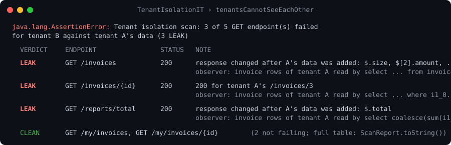

# tenant-guard

*[Türkçe sürüm](README.tr.md)*
[](https://github.com/yavuzhankursun/tenant-guard/actions/workflows/ci.yml) 

tenant-guard finds cross-tenant data leaks in a Spring/JDBC application's tests by watching from
inside PostgreSQL. A row-level-security "observer" policy reports every row the executor reads, and
a JDBC proxy matches those rows against the tenant the test is acting as. So it catches the leaks
that Hibernate's `@TenantId` filter and HTTP-level scanners can't see: native queries,
`JdbcTemplate`, reports and aggregates (`SUM`, `MAX`, `count(*)`) that never return a foreign row
as such.

Status: prototype. PostgreSQL only. Java 21, Spring Boot 3.5, JUnit 5.



Design decisions, in the order they were made, with what each one replaced: [docs/design-notes.md](docs/design-notes.md).

## Why inside the database

An outside-in scanner sees only HTTP. Say tenant B calls `GET /reports/total` and gets
`{"total": 1300}`. If the query is `SELECT sum(amount) FROM invoice` with the tenant filter
missing, 1300 already includes tenant A's invoices. But the response holds no field, id or
string that belongs to A, so nothing in it can be matched against A's data. The scanner can only
diff responses before and after A's data exists, and that diff misses aggregates whose value
doesn't move (`MAX` when A's values sit inside B's range, `EXISTS`, `count(*) > 0`).

Inside the database the question becomes simple: *which tenants' rows did this statement read?*
The policy runs once for every row the executor reads, whatever produced the SQL.

## How it works

`ObserverInstaller` creates a role `tg_app` (`NOLOGIN NOSUPERUSER NOBYPASSRLS`) and, on each
observed table, a permissive policy for that role only:

```sql
CREATE POLICY tg_observer ON invoice FOR ALL TO tg_app
  USING (tg_observe('invoice', tenant_id::text)) WITH CHECK (true);
-- tg_observe(): RAISE NOTICE 'tg|%|%', tbl, row_tenant; RETURN true;
```

The policy never filters anything. It only reports. `FORCE ROW LEVEL SECURITY` is not set, so
the table owner (Flyway, seeders) is never observed. `GuardedDataSource` wraps the app's
`DataSource`. While the guard is active, every borrowed connection runs
`SET ROLE tg_app; SET client_min_messages = notice`. While it is inactive, it runs `RESET ROLE`.

The path of one NOTICE, for tenant B running an unfiltered query:

```
 App / ORM        Statement proxy        pgjdbc             Postgres (role tg_app)     TenantGuard
    |                   |                   |                        |                      |
    | executeQuery(sql) |                   |                        |                      |
    |------------------>| harvest #1 (pgjdbc is about to clear the warning chain)           |
    |                   |------------------>|------- query --------->|                      |
    |                   |                   |                        | read row A-1         |
    |                   |                   |                        | policy: tg_observe() |
    |                   |                   |<-- NOTICE tg|invoice|A |                      |
    |                   |                   |   (SQLWarning chain)   |                      |
    |                   |<-- ResultSet -----|                        |                      |
    |                   | harvest #2 (after execute) ------------------------------------->| RowRead(invoice, A)
    |<-- ResultSet proxy|                   |                        |                      | Observation(sql, actor=B)
    | rs.next() ...     |  (ResultSet proxy: harvest on fetch/navigation, clearWarnings, close)  | -> Finding ACTOR_MISMATCH
    | stmt.close()      |  harvest #3 (before clearWarnings/close)                         |
```

Notes on the path:

- NOTICEs are the only channel that survives `ROLLBACK` and `READ ONLY` transactions. A log
  table written from the policy would be rolled back, and `READ ONLY` rejects the write outright.
- The warning chain is read with a cursor and never cleared, so the application still sees its
  own warnings. An ORM that logs and clears warnings can't swallow ours: we harvest before
  `clearWarnings` and before `close`.
- The observer sees rows the executor *read*, not rows that left the database. Postgres runs
  leakproof predicates (`=` on `text`/`bigint`) before the policy. Rows those predicates reject
  are never observed. That's why `WHERE tenant_id = 'B'` stays silent and `findById(A's id)` is
  reported as a read of exactly one row, A's.

## Modes

| Mode | What it needs | What it catches | What it misses |
|---|---|---|---|
| **Active** | the test names the actor: `guard.runAs("B", ...)` | any row of another tenant read on B's behalf, including a single-row `findById` IDOR (`ACTOR_MISMATCH`) | rows rejected by leakproof predicates before the policy |
| **Passive** | nothing (actor unknown) | one statement read rows of more than one tenant (`MULTI_TENANT_STATEMENT`) | `findById` IDOR (one row, one tenant). Noisy on JOINs and on legitimately cross-tenant queries (login, admin, schedulers) |
| **Differential** | baseline with B's data only, then seed A, call again, diff (`DifferentialProbe`) | **LEAK** = B's response changed because A's data exists (confirmed). **SUSPECT** = response unchanged but the observer saw A's rows | needs extreme seeding (below). Blind to booleans (`EXISTS`, `count(*) > 0`) and to cached responses |

Every observer finding is SUSPECT-level by itself. A correctly filtered JOIN still reads the
child table's foreign rows before the join discards them. The differential mode turns a SUSPECT
into a confirmed LEAK when the response actually changes.

**Extreme seeding.** If A's amounts lie inside B's range, an unfiltered `MAX` returns the same
value with or without A, and the diff sees nothing. With A seeded like B (100/200), `MAX` came
out SUSPECT only. `Extremes` gives the victim values at both
ends of every sortable type: amounts `0.01` / `999999999.99` (fit `numeric(12,2)`), instants and
dates `1970-01-02` / `2999-12-31`, and strings that sort first/last under C, ICU and glibc
collations. Seed A with both. Then `MAX`, `MIN` and `ORDER BY ... LIMIT 1` change as soon as A
leaks.

## Quick start

```java
@SpringBootTest
@TenantIsolationTest(tenantColumn = "tenant_id")   // tables: every table in the current schema with that column
class TenantIsolationIT {

    @TestConfiguration
    static class Seed {
        @Bean
        TenantSeeder seeder(JdbcTemplate jdbc) {          // called with the guard inactive, as the table owner
            return tenant -> {
                if (tenant.equals("A")) {                    // victim is seeded first: start clean
                    jdbc.execute("TRUNCATE invoice_line, invoice RESTART IDENTITY");
                }
                List<BigDecimal> amounts = tenant.equals("A")
                        ? Extremes.amounts()
                        : List.of(new BigDecimal("100"), new BigDecimal("200"));
                for (int i = 0; i < amounts.size(); i++) {
                    jdbc.update("INSERT INTO invoice (tenant_id, number, amount) VALUES (?, ?, ?)",
                            tenant, tenant + "-" + i, amounts.get(i));
                }
            };
        }
    }

    @Autowired InvoiceRepository invoices;

    @Test
    void tenantsCannotSeeEachOther(TenantGuard guard, ObserverSetup setup) {
        // Also set your app's own tenant context to B here; runAs only labels the reads.
        guard.runAs("B", invoices::findAll);

        assertThat(setup.skippedTables()).isEmpty();          // a skipped table is an unobserved table
        assertThat(guard.findings(Finding.Rule.ACTOR_MISMATCH)).isEmpty();
    }
}
```

Before each test the extension deactivates and resets the guard, calls the `TenantSeeder` bean
(if any) for `victim` ("A") and then `attacker` ("B"), installs the observer, activates the
guard, runs the self-check and resets it. After each test it deactivates the guard. Test methods
can take `TenantGuard`, `ObserverSetup` and `TenantSeeder` parameters. The annotation imports
`TenantGuardConfiguration` (guard bean + `DataSource` wrapper) through a meta-`@Import`, which
Spring Boot's test support honours.

- Auto-discovery skips tables whose RLS policies never grant `tg_app` anything, and quoted/mixed-case names. It
  logs a warning and lists them with a reason in `ObserverSetup.skippedTables()`. Explicit
  `tables = {...}` fail instead. Finding no observable table at all fails the test.
- Prefer seeding in `@BeforeEach`? Extension callbacks run *before* `@BeforeEach` methods, so the
  guard is already armed there. Call `guard.deactivate()`, seed, then `guard.activate();
  guard.reset()`.
- With `@SpringBootTest(classes = ...)`, Spring Boot ignores nested `@TestConfiguration` classes.
  List the seeder configuration in `classes` too.
- `ObserverSetup.warnings()` lists what the extension could not make safe, e.g. Spring scheduling
  being enabled. Setup failures say what to check (DataSource not guarded / missing / ambiguous,
  observer installed by a non-owner, self-check errors).

## Self-check

The worst failure mode for this tool is silent under-reporting: if RLS doesn't apply, a leaky app
produces zero findings, exactly like a clean one. So before each test `SelfCheck` fails loudly if:

- the effective role is a superuser or has `BYPASSRLS`. Testcontainers' default user is a
  superuser, and `SET ROLE tg_app` is what makes RLS apply at all;
- a `SELECT` on the one-row `tg_probe` table produces no observer NOTICE (policy missing, NOTICE
  filtered by `client_min_messages`, proxy not in the path).

## Verified behaviour

Each row is a test in `src/test` (`ObserverScenariosTest`, `DifferentialScenarioTest`,
`JdbcPathMatrixTest`, `TenantIsolationTestAnnotationTest`) against Postgres 16.

| Scenario | Result |
|---|---|
| `WHERE tenant_id = 'B'`, seq scan | no finding |
| unfiltered `SELECT sum(amount)` as B | `ACTOR_MISMATCH` (A) + `MULTI_TENANT_STATEMENT` |
| child table filtered through `JOIN invoice ... WHERE i.tenant_id = 'B'` | `ACTOR_MISMATCH` on `invoice_line`: **false positive**, rows read but discarded by the join |
| `@Transactional(readOnly = true)` / transaction rolled back | notices kept, finding raised |
| superuser connection | self-check fails (`superuser=true`) |
| table with its own permissive RLS policy | observer installed `AS RESTRICTIVE`; the app's policy still filters, rejected rows are never observed |
| table whose policies never grant `tg_app` anything | refused / skipped with the reason: a restrictive-only table denies every row |
| Hibernate `findAll()` as B | `ACTOR_MISMATCH` (A) |
| `findById(A's id)` as B (active) | caught |
| `findById(A's id)`, no actor (passive) | row observed, **no finding** |
| 33 JDBC access paths: Statement, PreparedStatement (single/reused), batch, CallableStatement, cursor (`fetchSize=1`), scrollable, JdbcTemplate, Hibernate (JPQL, native, stream, `find`), `unwrap(JDBC interface)` | all observed |
| differential: SUM report, `findAll` list | LEAK |
| differential: filtered list | CLEAN |
| differential: JOIN-filtered child table | SUSPECT |
| differential: `MAX`, `MIN`, `ORDER BY amount DESC LIMIT 1` with `Extremes` seed | LEAK |
| differential: `EXISTS(... WHERE lower(number) = 'b-3')` | SUSPECT: diff blind, observer is the only signal |
| differential: bare `EXISTS(SELECT 1 FROM invoice)` while B has rows | CLEAN: the scan stops at B's first row, A's rows are never read |


### What it catches: the leak corpus

`LeakCorpusTest` runs 33 leak patterns as tenant B and asserts all three layers per row
(observer = `ACTOR_MISMATCH`, passive = `MULTI_TENANT_STATEMENT`, diff = `DifferentialProbe`).
`CorpusMechanismTest` proves the mechanism behind every blind spot (planner order, owner rights).

| Pattern | Observer | Passive | Diff |
|---|---|---|---|
| JPQL / native / `JdbcTemplate` lists, `SUM`, `COUNT`, `MAX`, `MIN`, CTE, `ORDER BY ... LIMIT 1`, `Pageable`, Criteria API, `Specification`, DTO projection without `tenant_id`, `@Transactional(readOnly)`, `@Async`, `StatelessSession`, `getResultStream()`, SQL function (`SECURITY INVOKER`), view `WITH (security_invoker = true)` | caught | caught | LEAK |
| `findById(victim id)`, `IN (victim ids)` | caught | silent (one tenant per statement) | LEAK |
| `findById` then in-memory tenant check (404) | caught | silent | SUSPECT |
| `EXISTS ... WHERE lower(name) = ?` (not leakproof) | caught | caught | SUSPECT |
| `EXISTS ... WHERE name = ?` (leakproof), name nobody has | **blind** | blind | CLEAN |
| same, probing the victim's name | caught | silent | LEAK |
| child rows filtered through a JOIN on the parent's tenant (correct code) | false positive | false positive | CLEAN → SUSPECT |
| `@Cacheable` over a leaky query | **blind** after the baseline warmed the cache | blind | CLEAN; LEAK once `CacheManager` is cleared after seeding the victim |
| view without `security_invoker` | **blind**: RLS is checked as the view owner, who bypasses it | blind | LEAK |
| SQL function `SECURITY DEFINER` | **blind**: body runs as the owner | blind | LEAK |
| controls: `findByTenantId(B)`, `findByIdAndTenantId(victim id, B)` | silent | silent | CLEAN |

So the observer misses four things: leakproof predicates whose answer does not depend on the
victim, cached responses, default views and `SECURITY DEFINER` functions. The differential probe
covers the last two; clearing caches between phases covers the third; the first is narrow.

Five silent under-reporting bugs were found by these tests and fixed:

1. pgjdbc clears a statement's warning chain at the start of every `execute`, without going
   through `clearWarnings()`. A reused `PreparedStatement` lost the previous execution's notices.
   Fix: harvest before each execute.
2. With `fetchSize` set and autocommit off, notices from later cursor fetches land on the
   `ResultSet`, not the `Statement`. Every row after the first batch went unseen. Fix: proxy the
   `ResultSet` and harvest on navigation, `clearWarnings` and `close`.
3. `unwrap(Connection.class)` returned the raw driver connection, whose statements nobody
   observed. Fix: return the proxy when the requested type is a JDBC interface.
4. The chain cursor went stale when the driver cleared the chain where we could not see it, so
   new notices were skipped. Fix: a new chain head restarts the count.
5. Hikari hands out separate wrappers for `executeQuery` and `getResultSet`, so one driver
   `ResultSet` was wrapped twice and fetch notices counted twice. Fix: one proxy per driver
   `ResultSet`.

## Assumptions and limitations

- **PostgreSQL only.** The mechanism is RLS + `RAISE NOTICE` + pgjdbc's `SQLWarning` chain.
- **Schema owned by the app user.** The observer is installed through the guarded `DataSource`
  while inactive, i.e. with the app's own credentials. These must own the tables (Flyway, or
  migrations run as the app user), not Hibernate `ddl-auto` under a non-owner role. Grants target
  schema `public`.
- **No parallel test execution.** The actor and the findings are process-wide, not thread-local.
  That's on purpose: the tenant label survives `@Async` and thread pools.
- **Tables with their own RLS policies get a RESTRICTIVE observer.** Postgres ORs permissive
  policies, so a permissive always-true observer would switch the app's isolation off; a
  restrictive one is AND-ed instead. The app's policy then runs first and rows it rejects are never
  observed. A table whose policies never grant `tg_app` anything is refused: restrictive-only means
  deny-all and the observer would see nothing.
- **Leakproof predicates and early exits.** Rows rejected by `=` on text/bigint before the
  policy, or never reached (`EXISTS`, `LIMIT`), are not observed.
- **Views and `SECURITY DEFINER` functions run as their owner**, who bypasses RLS, so the observer
  does not see reads through them; the differential probe still does. Views
  `WITH (security_invoker = true)` and `SECURITY INVOKER` functions are observed.
- **Caches hide reads.** A `@Cacheable` result warmed during the baseline never reaches Postgres
  again. Clear the `CacheManager` after seeding the victim.
- **`@Scheduled` jobs run under the global actor.** The extension warns when scheduling is
  enabled; `tenantguard.scheduling=off` installs a `TaskScheduler` that runs nothing.
- **The `tg|` NOTICE prefix is spoofable** by the application's own `RAISE NOTICE`.
- **One NOTICE per row read.** Large seeds and full scans are slow. Seed a handful of rows.
- **`GRANT ... ON ALL TABLES` covers existing tables only.** Tables created after installation
  are not granted to `tg_app`.
- **Driver-specific `unwrap`** (e.g. to `PGConnection`) returns the raw connection, and
  statements created from it bypass the proxy.
- The write side (`WITH CHECK`) is not observed.

## Endpoint scanning

The HTTP layer drives every `GET` endpoint of the app as the attacker (B) against the victim's
(A) data, with the observer and the differential probe underneath. Endpoints are discovered from
Spring's `RequestMappingHandlerMapping`: no OpenAPI file, no token list.

```java
@SpringBootTest
@AutoConfigureMockMvc
@TenantIsolationTest(tenantColumn = "tenant_id")
class EndpointIsolationIT {

    @Test
    void tenantsCannotSeeEachOther(TenantGuard guard, @Autowired MockMvc mockMvc,
                                   @Autowired ApplicationContext context, @Autowired DataSource dataSource) {
        EndpointScanner.builder(mockMvc, guard)
                .endpoints(EndpointDiscovery.discover(context))
                .exclude("/api/v1/tenants/**")                        // platform-admin endpoints, by design cross-tenant
                .seeder(tenant -> /* insert that tenant's rows, as the owner */)
                .authenticator(tenant -> request -> { request.addHeader("X-Tenant", tenant); return request; })
                .resourceIds(ResourceIds.builder()
                        .id("/invoices/{invoiceId}/lines/{lineId}", "lineId", tenant -> /* override */)
                        .fallback(new TableGuessingResourceIds(dataSource, "tenant_id"))
                        .build())
                .build()
                .scan()
                .assertNoLeaks();
    }
}
```

The scan runs in phases: seed B → record a baseline of every endpoint without path variables as B
(twice, to mask fields that change on every call) → seed A → call every endpoint as B, with A's
ids substituted into `{id}`-style variables. Verdicts:

| Verdict    | Meaning                                                                                   |
|------------|-------------------------------------------------------------------------------------------|
| `LEAK`     | 2xx **with data** on an endpoint called with A's id, or the response changed after A's data was added |
| `SUSPECT`  | Response unchanged / empty / 403 / 404, but the observer saw A's rows being read during the call |
| `CLEAN`    | Neither                                                                                   |
| `SKIPPED`  | Id could not be resolved (reason in the note), or 401: the authenticator is probably wrong |
| `EXCLUDED` | Matched `.exclude(antPattern)` / `.excludeIf(predicate)`; never called, listed with the rule |
| `ERROR`    | 5xx or handler exception. Fails `assertNoLeaks()`: a crash is not proof of safety          |

**Empty bodies are not leaks.** A correctly filtered query finds nothing for the victim's id and
still answers `200 []`, `{}`, `null`, `0`, `0.00` or `false`. Such a 2xx is SUSPECT when the
observer saw the victim's rows, CLEAN otherwise (`200 with empty body [] for tenant A's
/invoices/3/lines`). The check is flat on purpose: `{"items": [], "total": 0}` still counts as
data. If the victim's real value could be `0` or `false`, seed it with `Extremes`.

Excluding every endpoint, or resolving none, fails with `No endpoint was verified`.

`assertNoLeaks()` prints a table like this one from the sample app:

```
Tenant isolation scan: 3 of 5 GET endpoint(s) failed for tenant B against tenant A's data (3 LEAK)
  VERDICT  ENDPOINT           STATUS NOTE
  LEAK     GET /invoices      200    response changed after tenant A's data was added: $.size, $[2].amount, ...
  LEAK     GET /invoices/{id} 200    200 for tenant A's /invoices/3; observer: invoice rows of tenant A read by select ... where i1_0.id=?
  LEAK     GET /reports/total 200    response changed after tenant A's data was added: $.total; observer: ...
```

`{id}` → table mapping guesses the table from the preceding path segment and the variable name
(`/invoices/{id}` → `invoice`, `{invoiceLineId}` → `invoice_line`), validates every identifier
before it reaches SQL, and reports `SKIPPED` with the names it tried when nothing matches.
Nested ids are resolved independently, so `/invoices/{a}/lines/{b}` usually needs an override.
Only `GET` is scanned; query parameters, pagination and request bodies are not generated.
Calls are sequential because the guard's actor is global.

## How this is verified

- **231 tests** against Postgres 16 in Testcontainers, on every push (GitHub Actions).
- **33-path JDBC access matrix** (`JdbcPathMatrixTest`): the same leak through every Statement,
  PreparedStatement, batch, callable, cursor, JdbcTemplate, Hibernate and `unwrap` path.
- **33-pattern leak corpus** (above), every blind spot with a mechanism test.
- **Mutation testing** (`mvn -Pmutation org.pitest:pitest-maven:mutationCoverage`, PIT with the
  STRONGER mutators on the JDBC core): 96% of 227 mutants killed; the 8 survivors are equivalent
  (void returns, proxy argument shapes). A broken harvest cannot stay green.
- **One field run** on a production Spring Boot app with 231 GET endpoints, 98 migrations and 63
  tenant tables: 1 confirmed leak (a branch-name subquery without a tenant filter), 1 write-side
  IDOR found by reading the code, 5 unrelated 500s. The first run also produced 15 false LEAKs;
  the empty-body rule and endpoint exclusion below came out of it and remove 12 of them.

## Roadmap

- Environment matrix in CI: Postgres 13–17, Spring Boot 3.2–3.5 / Hibernate 6.4–6.6, pgjdbc
  42.6/42.7, Hikari / Tomcat / DBCP2 / c3p0 / no pool, `int` / `uuid` / `text` tenant ids,
  non-`public` schemas, Gradle.
- Runs against open-source multi-tenant Spring projects.
- Warn about views without `security_invoker` and `SECURITY DEFINER` functions at install time.
- POST/PUT/DELETE scanning with generated bodies; DELETE last with re-seeding.
- Write-side observation (`INSERT`/`UPDATE` into another tenant).
- Per-session NOTICE nonce instead of the fixed `tg|` prefix.
- `ALTER DEFAULT PRIVILEGES` and non-`public` schemas.

## Related tools

- **AuthProbe**: outside-in.
- **Burp Autorize**: outside-in.
- **Snyk API & Web**: outside-in.
- **Unit 42 BOLABuster**: outside-in.

tenant-guard complements them from the inside. It sees reads that never show up in a response,
and it can't see anything that doesn't touch Postgres.
